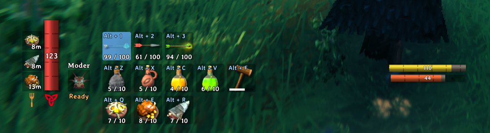
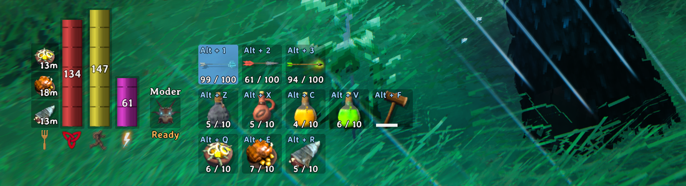

# SteadyBars

Valheim mod that adds stamina and eitr bars next to the health bar, in the same style, and they stay on screen all the time. The game's own stamina and eitr bars under your character still work as always.

| Before | After |
|---|---|
|  |  |

- Stamina goes right of the health bar, eitr after it. Each bar grows with your max like the health bar does, and the number is your current value.
- Under each bar there is an icon like the health one: the Run skill icon for stamina and the Elemental Magic one for eitr.
- The eitr bar only shows when your max eitr is above 0, so you don't see it until you eat eitr food.
- The guardian power icon moves right to make room.

## Using ExtraSlots?

ExtraSlots puts its quick slots right of the health bar, so the new bars overlap them. Move them right in `BepInEx/config/shudnal.ExtraSlots.cfg`, it's the `x` in the `Offset` of the ammo, quick and food slots (230 by default). How much depends on how many bars you have on:

| Bars on | Move right | `x` |
|---|---|---|
| Both (default) | 88 | 318 |
| Only one (`ShowStamina` or `ShowEitr` false) | 44 | 274 |

With both bars on:

```ini
Offset = {"x":318.0,"y":228.0}   # ammo slots
Offset = {"x":318.0,"y":156.0}   # quick slots
Offset = {"x":318.0,"y":84.0}    # food slots
```

It counts the bars turned on in the config. The eitr bar keeps its space even when it's hidden because you have no eitr.

Any other mod that puts something right of the health bar needs the same move.

## Install

You need [BepInExPack Valheim](https://thunderstore.io/c/valheim/p/denikson/BepInExPack_Valheim/). Only in your game, nothing on the server.

Build and copy the DLL to your game:

```sh
dotnet build src/SteadyBars -c Release -p:Deploy=true
```

It copies `SteadyBars.dll` to `BepInEx/plugins` of the default Steam install, pass `-p:ValheimDir=...` for other path.

## Configuration

File: `BepInEx/config/rkmax.steadybars.cfg`. Changes apply next time you log in.

- `ShowStamina` (true): adds the stamina bar.
- `ShowEitr` (true): adds the eitr bar.
